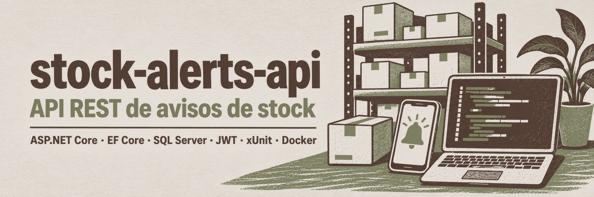
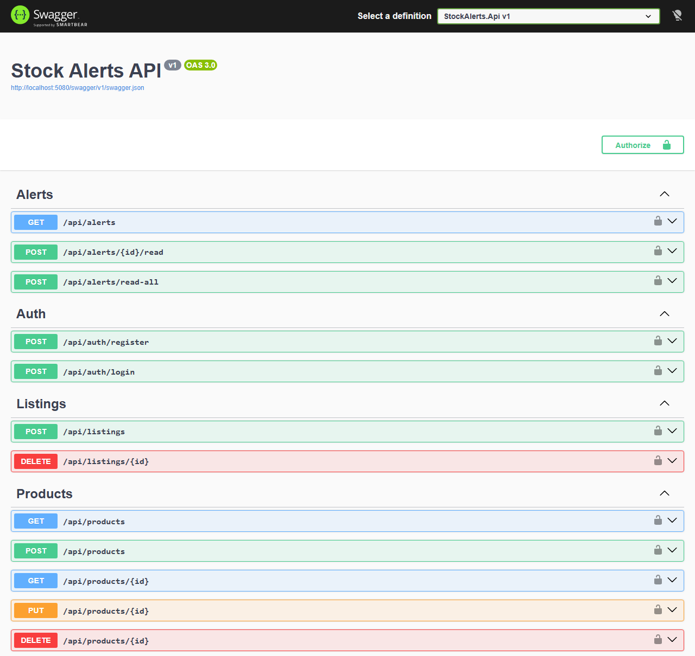
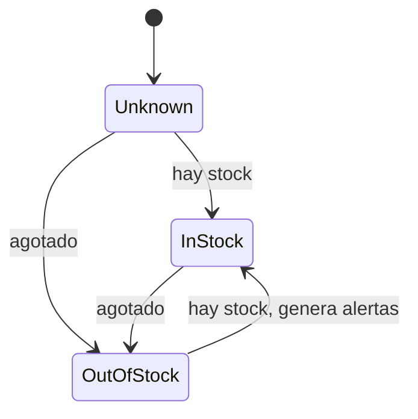

<p align="center">
  
</p>

# stock-alerts-api

[](https://github.com/josemcastrodev/stock-alerts-api/actions/workflows/ci.yml)


API REST en ASP.NET Core (.NET 10) que avisa a los usuarios cuando un producto vuelve a tener stock en una tienda.

Es un **proyecto de ejemplo**. Reproduce, simplificado y en .NET, el backend de [TCG Stock Up](https://tcgstockup.com), una aplicación mía que en producción está hecha con NestJS. No es el código de producción: aquí no hay scraping ni llamadas a webs externas (el stock lo da una fuente simulada) y el alcance está recortado para que se pueda leer en unos minutos.

Autor: [Jose María Castro](https://josemcastro.dev).

## Arrancarlo

Solo hace falta el SDK de .NET 10:

```bash
git clone https://github.com/josemcastrodev/stock-alerts-api.git
cd stock-alerts-api
dotnet run --project src/StockAlerts.Api
```

Y abrir <http://localhost:5080/swagger>.

<p align="center">
  
</p>

En desarrollo la aplicación usa SQLite (crea `stockalerts.dev.db` en la carpeta del proyecto), carga un catálogo de demostración y crea un usuario administrador. Sus credenciales, igual que la clave JWT de desarrollo, están en `src/StockAlerts.Api/appsettings.Development.json`.

Para ver una alerta: regístrate en `POST /api/auth/register`, pulsa *Authorize* en Swagger con el token, suscríbete a un producto con `PUT /api/subscriptions/{productId}` y espera. El worker comprueba el stock cada 15 segundos contra la fuente simulada, que repite un guion fijo de ocho pasos (con fallos incluidos), así que en un máximo de dos minutos `GET /api/alerts` devuelve la alerta.

### Con SQL Server

Con Docker:

```bash
cp .env.example .env
docker compose up --build
```

La API queda en <http://localhost:8080> en modo Production (sin Swagger UI) y aplica las migraciones al arrancar.

Sin Docker, contra una instancia propia (por ejemplo LocalDB), basta con cambiar dos valores de configuración:

```powershell
$env:Database__Provider = "SqlServer"
$env:ConnectionStrings__Default = "Server=(localdb)\MSSQLLocalDB;Database=StockAlerts;Trusted_Connection=True"
dotnet run --project src/StockAlerts.Api
```

## Endpoints

| Método | Ruta | Acceso | Descripción |
| --- | --- | --- | --- |
| POST | `/api/auth/register` | Público | Crea un usuario y devuelve un token JWT |
| POST | `/api/auth/login` | Público | Devuelve un token JWT |
| GET | `/api/products` | Público | Listado paginado (`page`, `pageSize`) con filtros `search`, `category` e `inStock` |
| GET | `/api/products/{id}` | Público | Producto con sus listings: tienda, URL, precio, estado y última comprobación |
| POST | `/api/products` | Admin | Crea un producto |
| PUT | `/api/products/{id}` | Admin | Modifica un producto |
| DELETE | `/api/products/{id}` | Admin | Borra un producto con sus listings, suscripciones y alertas |
| GET | `/api/stores` | Público | Lista las tiendas |
| GET | `/api/stores/{id}` | Público | Devuelve una tienda |
| POST | `/api/stores` | Admin | Crea una tienda |
| PUT | `/api/stores/{id}` | Admin | Modifica una tienda |
| DELETE | `/api/stores/{id}` | Admin | Borra una tienda con sus listings |
| POST | `/api/listings` | Admin | Da de alta un producto en una tienda |
| DELETE | `/api/listings/{id}` | Admin | Borra un listing |
| GET | `/api/subscriptions` | Usuario | Mis suscripciones |
| PUT | `/api/subscriptions/{productId}` | Usuario | Me suscribe a un producto (idempotente) |
| DELETE | `/api/subscriptions/{productId}` | Usuario | Cancela la suscripción |
| GET | `/api/alerts` | Usuario | Mis alertas, paginadas; `unreadOnly=true` deja solo las no leídas |
| POST | `/api/alerts/{id}/read` | Usuario | Marca una alerta como leída |
| POST | `/api/alerts/read-all` | Usuario | Marca todas como leídas |
| GET | `/health` | Público | Health check, incluida la conexión a la base de datos |

Los errores se devuelven como `ProblemDetails` (RFC 9457); los de validación incluyen el detalle por campo.

## Decisiones



Una comprobación fallida no aparece en el diagrama porque no mueve el estado.

- **Un fallo al comprobar no es "agotado".** Una comprobación puede terminar en `InStock`, `OutOfStock` o `Failed`, pero el estado de un listing solo puede ser `Unknown`, `InStock` u `OutOfStock`: si la comprobación falla, el estado no se toca. En la aplicación real guardar el fallo como "agotado" hacía que la siguiente comprobación correcta pareciera una reposición y se enviaran avisos falsos.
- **Solo hay alerta en la transición confirmada `OutOfStock -> InStock`.** `Unknown -> InStock` es la primera vez que se ve el listing, no una reposición. El estado y las alertas se guardan en la misma transacción y `Status` es *concurrency token*, así que si dos instancias detectan la misma reposición solo una la guarda y no hay alertas duplicadas.
- **La regla está en el dominio, no en el worker.** `Listing.RecordCheck` decide, `StockCheckService` orquesta y `StockCheckWorker` solo pone el temporizador; por eso la regla se prueba sin base de datos y sin levantar la aplicación.
- **Abstracciones solo donde hay una regla que proteger.** La comprobación de stock va detrás de `IStockSource` e `IStockCheckRepository` porque es lo que se quiere probar aislado; el CRUD usa el `DbContext` directamente, porque un repositorio genérico ahí sería una capa de paso. Por lo mismo no hay MediatR ni AutoMapper, y la validación se hace con DataAnnotations.
- **SQL Server es la base de datos; SQLite está para arrancar sin instalar nada.** Las migraciones son de SQL Server. En desarrollo y en los tests se usa SQLite y el esquema se crea directamente desde el modelo, lo que evita mantener dos juegos de migraciones.
- **Ningún secreto en el repositorio.** La única clave JWT que hay es la de desarrollo, y lo dice su propio valor; en cualquier otro entorno la aplicación no arranca si no recibe `Jwt__Key` por variable de entorno.

## Tests

```bash
dotnet test
```

La CI ejecuta estos tests y, aparte, levanta el `docker compose` completo (API en modo Production contra SQL Server, con las migraciones aplicadas) y comprueba `/health`.

- `tests/StockAlerts.UnitTests`: la regla de transición de stock (`ListingTests`) y la generación de alertas (`StockCheckServiceTests`), con dobles escritos a mano y sin base de datos.
- `tests/StockAlerts.IntegrationTests`: la API real con `WebApplicationFactory` sobre SQLite en memoria. Cubre autenticación y autorización, el catálogo, el flujo completo (registro, login, suscripción, reposición, alerta), el caso de dos instancias detectando la misma reposición y que la aplicación no arranca sin clave JWT.

## Estructura

```text
src/
  StockAlerts.Core/             Dominio y caso de uso. No depende de EF Core ni de ASP.NET Core.
    Entities/                   Listing.RecordCheck contiene la regla de transición.
    StockChecks/                StockCheckService, IStockSource, IStockCheckRepository.
  StockAlerts.Infrastructure/   EF Core (SQL Server y SQLite), migraciones, JWT y fuente de stock simulada.
  StockAlerts.Api/              Controllers, contratos, StockCheckWorker y Program.cs.
tests/
  StockAlerts.UnitTests/
  StockAlerts.IntegrationTests/
```

Para leerlo en orden: `Listing.cs`, `StockCheckService.cs`, `StockCheckWorker.cs` y los tests de `ListingTests.cs`.

### Migraciones

```bash
dotnet tool restore
dotnet ef migrations add NombreDeLaMigracion --project src/StockAlerts.Infrastructure --startup-project src/StockAlerts.Infrastructure
```

## Fuera del alcance

- Las alertas se guardan y se consultan por la API; no se envían por email ni por push.
- El worker recorre todos los listings uno a uno en cada ciclo. Con un catálogo grande habría que procesar por lotes y limitar la concurrencia por tienda.
- No hay refresh tokens ni rate limiting.
